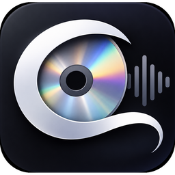
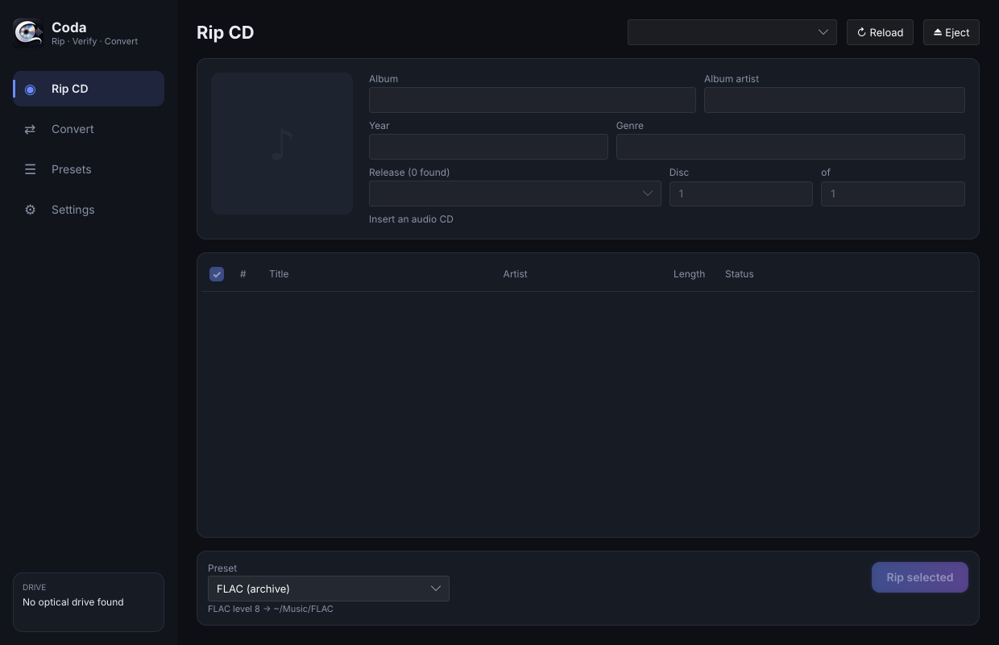
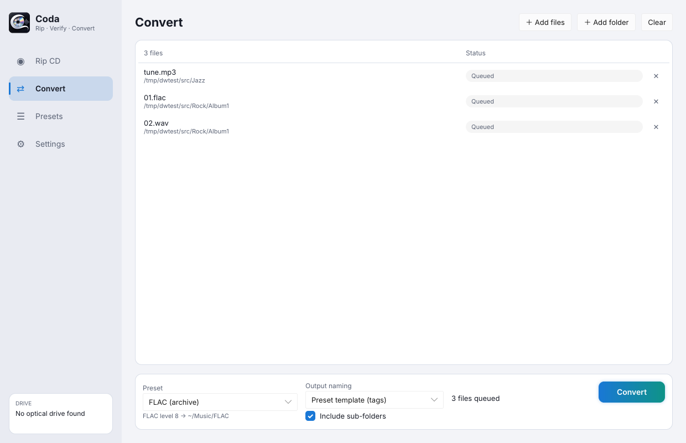

# Coda

A Linux-native CD ripper and audio converter in one app, inspired by dBpoweramp. Written in Rust with a Slint interface.

The name comes from the Latin *cauda*, "tail": in music a coda is the concluding passage that brings a piece to its end.





## What it does

| Requirement | How Coda handles it |
|---|---|
| Bit-perfect, verified rips | Raw CD-DA reads over SCSI pass-through (SG_IO, `READ CD`), drive read offset correction, AccurateRip v1 + v2 verification, secure re-reading of anything AccurateRip can't confirm, optional C2 error pointers, a rip log with AccurateRip and copy CRCs, and MD5 verification of every lossless encode against the ripped audio. |
| Drive offsets | Looked up automatically in AccurateRip's published drive offset table on first use and saved per drive. If your drive isn't listed, the offset is detected from any CD that is in the AccurateRip database (key-disc method). It can also be set by hand. |
| Metadata and artwork | MusicBrainz disc ID lookup (with fuzzy TOC fallback), then GnuDB, then Discogs (matched by the disc's barcode and verified against its track lengths), plus a manual "Search Discogs" button. Artwork from the Cover Art Archive at original resolution, falling back to the iTunes catalogue (up to 3000×3000) when the CAA image is missing or small. Oversized scans are downscaled (default cap 3000 px, configurable) and embedded in every file, plus `cover.jpg` in each album folder. ISRCs and the disc barcode (MCN) are read from the disc itself. |
| Presets with multiple outputs | A preset is a list of outputs, each with its own format, quality, destination folder and naming template. "FLAC + MP3 V0" writes lossless to your archive and MP3 to a portable folder from one rip. |
| Converter formats | Output: FLAC, MP3, AAC (M4A), Apple Lossless (ALAC), Opus, Ogg Vorbis, WMA, WAV, AIFF, WavPack, TTA. Input: all of those plus Monkey's Audio (APE), Musepack, DSD (DSF/DFF), TAK, Matroska audio, CAF, W64 and anything else ffmpeg decodes. |
| Speed | One encoder process per CPU thread. During a rip, tracks are encoded on all cores while the next track is being read. |
| Batch conversion | Add files and whole folder trees. Name outputs from tags, mirror the source folder structure, or write next to the source. Tags and artwork are carried across every format. |
| Right-click menus | Dolphin (KDE Plasma, CachyOS's default), Nautilus (GNOME), Nemo (Cinnamon), Caja (MATE), Thunar (Xfce), PCManFM-Qt (LXQt) and "Open With" everywhere. Each preset gets its own entry for one-click conversion with a desktop notification when done. |

## How rip verification works

1. Each track is read once at full speed, shifted by the drive's read offset.
2. Its AccurateRip v1 and v2 checksums are compared against the database. A match means other people's independent rips of the same pressing produced identical audio, so the track is proven bit-perfect and the next track starts.
3. If AccurateRip can't confirm it (disc not in the database, or a mismatch), the whole track is read again after forcing the drive to discard its cache. Every sector that differs between the two passes, or that the drive flagged with C2 errors, is re-read (cache defeated each round) until the same data comes back the required number of times (default 2) or the retry limit is reached (default 20).
4. The status column and the rip log say exactly what happened: **Accurate** (AccurateRip match, with confidence), **Secure** (two independent reads agree), or **Suspect** (sectors that never read consistently).

Lossless outputs are then decoded again and their audio MD5 compared to the rip, so an encoder fault can't slip through either.

### About AccurateRip

AccurateRip has no official public API, but its database can be read by anyone and its format is well documented. Several open-source tools use it (CUETools, whipper, ARver). Reading is all Coda does. Submitting results is restricted to licensed rippers, so Coda never submits. If you plan to distribute Coda publicly, it would be courteous to ask Illustrate (the makers of dBpoweramp and AccurateRip) for permission, as some open-source projects have done.

## Install

### Any distribution: `install.sh`

```sh
./install.sh            # check, offer to install what's missing, build, install for your user
./install.sh --check-only
./install.sh --yes      # don't ask before installing packages
./install.sh --system   # put the binary in /usr/local/bin instead of ~/.local/bin
```

The installer recognises Arch and derivatives (CachyOS, EndeavourOS, Manjaro), Debian/Ubuntu/Mint, Fedora, openSUSE and Void, and checks:

* **Build:** Rust 1.95 or newer, a C compiler, pkg-config, fontconfig development files
* **Runtime:** ffmpeg (and which of its MP3, Opus, Vorbis, WMA and WavPack encoders are present), libxkbcommon, Wayland, EGL/OpenGL, xdg-desktop-portal (file dialogs) and notify-send (optional)
* **CD drive:** whether your user can read `/dev/sr*`, with the exact `usermod` command if not

Missing packages are installed with your package manager after you confirm. If your distribution's Rust is too old (common on Debian/Ubuntu), it offers rustup instead. Everything is checked again before building. It then installs the binary, the icon at all standard sizes, the application menu entry and the right-click menus.

### CachyOS / Arch package

```sh
cd packaging/arch && makepkg -si
coda install-integration   # per-preset right-click entries (also a button in Settings)
```

`makepkg -s` installs the dependencies itself. The package (`coda-ripper`) installs the binary, icons, menu entry and a basic "Convert with Coda" Dolphin entry system-wide. `install-integration` adds the per-preset entries for your user and refreshes them automatically when you edit presets.

### Drive access

Your user needs read access to `/dev/sr0`. On Arch-based systems logged-in desktop users normally have it. If not: `sudo usermod -aG optical $USER` (`cdrom` on Debian/Ubuntu), then log out and in.

## Use

* **Rip CD**: insert a disc and it is detected automatically. Pick the release if MusicBrainz offers several, edit anything, click the artwork to replace it, choose a preset and press **Rip selected**.
* **Tag**: see below.
* **Convert**: drag files or folders from your file manager onto the window (from any page), use the Add buttons, or right-click them in your file manager. Choose a preset and naming mode, press **Convert**. Drag and drop works natively on both Wayland and X11.
* **Presets**: add outputs, pick format and quality, set destination and template. The example line shows the resulting path as you type.
* **Command line**:

```sh
coda convert --preset "FLAC + MP3 V0 (portable copy)" ~/Downloads/album
coda convert --preset "Opus 160 kbps" --naming mirror ~/Music/FLAC
coda --tag ~/Music/Unsorted
coda presets
coda inspect file.flac
```

### Tag

Fix or complete the tags of files you already have, one album or hundreds at a time.

1. Drag files or folders onto the Tag page (or Add, or right-click → Coda → Tag…). Files are grouped into albums automatically, even across CD1/CD2 folders.
2. **Search** looks the album up in MusicBrainz and Discogs. Each result is scored against your files: every file is paired with a release track by track number, length and title, so wrong or missing titles don't stop a match, and other editions (live, remasters with different lengths) score low or are rejected.
3. Review the **Current → New** view: album fields, artwork and every track side by side, with changes outlined. Edit anything (your own values always win), untick files you don't want touched, choose a different match, or press **Use current tags** to tag entirely by hand.
4. **Save album** writes the ticked files. Optionally **rename** them from the new tags (within the same folder).

For a whole library: **Auto-match all** applies matches of 80% or better and marks the rest "Review" with their candidates ready to choose from; **Save all matched** then writes everything you've accepted.

Re-tagging only changes the fields shown. Everything else in the file is preserved: ReplayGain, lyrics, custom fields, other pictures, and the existing artwork unless you tick **Replace artwork** (on by default only when the new image is bigger). Verified for FLAC, MP3, M4A, Opus, Ogg Vorbis, WavPack, AIFF and WMA.

### Metadata sources

1. **MusicBrainz** by disc ID (exact), then by table of contents (fuzzy).
2. **GnuDB** (the freedb successor) when MusicBrainz has nothing.
3. **Discogs** when MusicBrainz has nothing. Discogs has no disc-ID lookup, so Coda searches by the barcode stored on the CD (or by the GnuDB artist and album) and keeps only releases with a disc of the same track count, ranked by how closely the track lengths match. Results include label, catalogue number, barcode and style, and the Discogs release ID is written to FLAC/Opus/Vorbis tags as `DISCOGS_RELEASE_ID`.

The **Search Discogs** button on the Rip page searches by the album and artist in the fields, so you can fill gaps or pick a specific pressing at any time. A free Discogs personal access token (discogs.com/settings/developers → Generate new token, pasted into Settings) may be needed for search and cover images, and raises the rate limit.

### Appearance

Settings → Appearance offers **Follow system**, **Light** and **Dark**. Follow system reads your desktop's light/dark preference (the standard XDG setting that KDE Plasma, GNOME and others publish) and switches live when you change it. Eight colour schemes (Aurora, Ocean, Emerald, Sunset, Rose, Amber, Graphite, Nord) recolour buttons, switches, tick boxes, highlights and progress bars, with tuned variants for light and dark mode. Both choices apply instantly and are remembered.

### Naming templates

Variables: `{albumartist} {artist} {album} {title} {track} {tracktotal} {disc} {disctotal} {year} {genre} {composer} {filename} {reldir} {format}`

Anything in `[square brackets]` disappears when a variable inside it is empty. The default template is:

```
{albumartist}/{album}[ (Disc {disc})]/[{track} - ]{title}
```

That gives `Artist/Album/01 - Title.flac`, and `Artist/Album (Disc 2)/01 - Title.flac` only for multi-disc sets. With "Portable file names" on (default), characters that FAT/exFAT/NTFS devices reject are replaced.

Settings and presets live in `~/.config/coda/config.toml`.

## Known limitations and next steps

* **Not yet run against a physical drive.** The drive layer (TOC, `READ CD`, C2, ISRC/MCN, eject) follows the MMC specification and the same approach as cdparanoia/whipper, and the checksum and offset logic are unit-tested, but please try a few known discs first and compare the log with AccurateRip results from another ripper.
* Pre-gaps and hidden track one audio (HTOA) are not detected. Gaps are appended to the previous track, which is what AccurateRip expects, but cue sheets contain only `INDEX 01`.
* CUETools database (CTDB) verification and repair are not implemented yet. `cdtoc` already computes CTDB IDs, so this is a natural next step.
* WMA and TTA tags are written by ffmpeg rather than lofty, so MusicBrainz IDs aren't stored in those two formats.

## Project layout

```
src/cdrom.rs        Linux drive access: TOC ioctls, SG_IO READ CD, C2, ISRC/MCN, eject
src/ripper.rs       disc loading, secure read engine, offset detection, logs, cue sheets
src/accuraterip.rs  AccurateRip v1/v2 checksums, database parsing, drive offsets
src/metadata.rs     MusicBrainz, GnuDB, Cover Art Archive, iTunes artwork
src/discogs.rs      Discogs search, release parsing and track-length matching
src/encoder.rs      ffmpeg job runner, source probing, lossless verification, worker pool
src/converter.rs    folder scanning and job planning
src/formats.rs      output formats and encoder settings
src/tags.rs         tag and artwork reading/writing, safe in-place updates (lofty, ffmpeg fallback)
src/tagger.rs       album grouping, release search and track matching for re-tagging
src/naming.rs       path templates
src/integration.rs  file manager context menus
src/dnd.rs          drag and drop from file managers (Wayland protocol + X11)
src/gui.rs          UI controller
ui/app.slint        interface
```

Licensed GPL-3.0-or-later.
